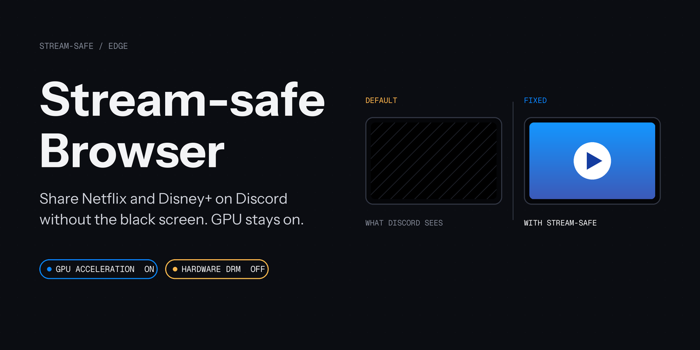
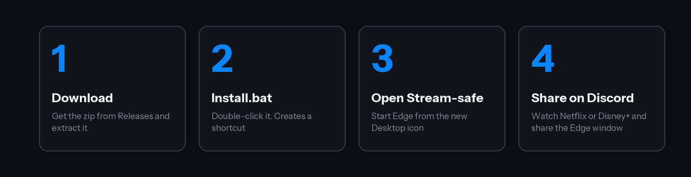
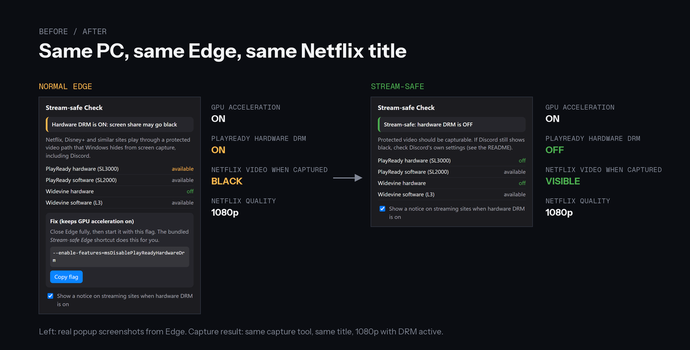

<p align="center"></p>

# Stream-safe Browser

**แชร์จอ Discord ตอนดู Netflix / Disney+ แล้วจอดำ? แก้ได้ โดยไม่ต้องปิด Graphics acceleration**

[English](README.en.md) · ภาษาไทย

[-0a84ff?style=for-the-badge)](https://github.com/Kensukeimagery/stream-safe-browser/releases/latest/download/stream-safe-browser-windows.zip)
[](https://github.com/Kensukeimagery/stream-safe-browser/releases/latest)
[](LICENSE)

> ทดสอบแล้วบน **Microsoft Edge (Windows 11)** เบราว์เซอร์อื่นดู [ตารางด้านล่าง](#ใช้กับเบราว์เซอร์ไหนได้บ้าง) ว่าทดสอบแล้วหรือยัง

## ติดตั้งใน 3 ขั้นตอน

1. กดปุ่ม **ดาวน์โหลด** ด้านบน แล้วแตกไฟล์ zip (คลิกขวา → Extract All)
2. ดับเบิลคลิก **`Install.bat`** (ถ้า Windows ขึ้นเตือน กด *More info → Run anyway*)
3. เปิด Edge จากไอคอนใหม่ชื่อ **Microsoft Edge (Stream-safe)** บน Desktop แล้วแชร์จอ Discord ได้เลย

ถ้า Edge เปิดค้างอยู่ ทางลัดจะถามว่าจะรีสตาร์ตไหม กด **Yes** (แท็บเดิมจะกลับมา)

ลบออก: ดับเบิลคลิก `Uninstall.bat`

## ตัวอย่างการใช้งาน



## ตัวอย่างก่อน / หลัง



ภาพ popup เป็นภาพจริงจาก Edge ส่วนผลการจับภาพวัดบน Netflix จริง (ดูหัวข้อ "ผลทดสอบจริง" ด้านล่าง) ไม่ได้ใส่ภาพหน้าจอ Netflix เพราะเป็นเนื้อหามีลิขสิทธิ์

## ทำไมจอถึงดำ

เว็บสตรีมมิ่งใช้ DRM เมื่อเปิด GPU, Edge จะใช้ **PlayReady hardware DRM** ซึ่ง Windows ซ่อนจากโปรแกรมจับภาพหน้าจอทุกตัว รวมถึง Discord
การปิด GPU แก้ได้เพราะไปปิด DRM ตัวนี้ด้วย แต่ทำให้บางเว็บกระตุก

ตัวนี้ปิด **เฉพาะ hardware DRM** ส่วน GPU ยังทำงานเต็มที่:

| | GPU | PlayReady hardware | PlayReady software |
|---|---|---|---|
| ปกติ | เปิด | เปิด (จอดำ) | มี |
| ปิด GPU | ปิด | ปิด | ไม่มี |
| **Stream-safe** | **เปิด** | **ปิด** | **มี** |

## Extension ตรวจสถานะ (ไม่บังคับ)

ใน `extension/` เป็น extension เล็กๆ ที่บอกว่าตอนนี้ hardware DRM เปิดหรือปิด และเตือนบนเว็บสตรีมมิ่ง
ติดตั้ง: เปิด `edge://extensions` → เปิด **Developer mode** → **Load unpacked** → เลือกโฟลเดอร์ `extension`
ถ้าขึ้น *Stream-safe: hardware DRM is OFF* แปลว่าใช้งานได้

## ผลทดสอบจริง (Edge 156, Windows 11, GTX 1070)

ทดสอบบนบัญชี Netflix จริง เล่นเรื่องเดียวกันที่ 1080p ด้วย DRM (`mediaKeys` เปิด) และใช้เครื่องมือจับภาพตัวเดียวกัน:

| โหมด | `PlayReady hardware` | ภาพวิดีโอที่จับได้ |
|---|---|---|
| Edge ปกติ (GPU เปิด) | เปิด | **ดำ** |
| Stream-safe (GPU เปิด + flag) | ปิด | **เห็นภาพปกติ** |

- Netflix ยังเล่น **1080p** ได้ในโหมด Stream-safe
- Disney+ เล่นได้และ DRM ทำงาน แต่ช่วงเริ่ม (วิดีโอแนะนำ 480p) ยังไม่ใช่เส้นทาง hardware จึงไม่ใช่การเทียบที่ชัด
- การจับภาพด้วย Windows Graphics Capture ในเครื่องทดสอบไม่ได้ดำแม้ในโหมดปกติ ผลของ Discord จึงขึ้นกับโหมดจับภาพของ Discord (ดูหัวข้อถัดไป) และยังไม่ได้ยืนยันกับ Discord จริง รบกวนช่วยรายงานผลใน Issues

## ใช้กับเบราว์เซอร์ไหนได้บ้าง

| เบราว์เซอร์ | สถานะ | ที่รู้จริง |
|---|---|---|
| **Microsoft Edge** (Windows 11) | ✅ **ทดสอบแล้ว ใช้ได้** | วัดจริงบน Netflix: ปกติจอดำ, Stream-safe เห็นภาพ และยัง 1080p |
| Edge Beta / Dev / Canary | ⚪ ยังไม่ทดสอบ | เอนจินเดียวกัน น่าจะใช้ flag เดียวกันได้ ลอง `custom` |
| Google Chrome | ⚪ ยังไม่ทดสอบ | ไม่ได้ติดตั้งในเครื่องทดสอบ Chrome ไม่มี PlayReady จึงอาจไม่เจอปัญหานี้เลย flag ในสคริปต์ยังไม่ยืนยัน |
| Brave | 🟡 ทดสอบแล้วแต่ **ตัดสินไม่ได้** | โปรไฟล์ใหม่ไม่มี Widevine (Brave ปิดไว้จนเปิดเอง) ทุกระดับ DRM เป็น false จึงไม่มีอะไรให้วัด |
| Vivaldi | ⚪ ยังไม่ทดสอบ | มีโหมดในสคริปต์ ใช้ flag แบบ Chrome ซึ่งยังไม่ยืนยัน |
| Opera / Opera GX | ⚪ ยังไม่ทดสอบ | ใช้โหมด `custom` |
| Firefox และตัวแตก | ❌ ไม่รองรับ | คนละเอนจิน ไม่มี flag นี้ และยังไม่มีสวิตช์ที่ยืนยันแล้ว |
| macOS / Linux / มือถือ | ❌ ไม่รองรับ | โปรเจกต์นี้เป็น Windows เท่านั้น (Windows 10 ก็ยังไม่ได้ทดสอบ) |

**คู่มือติดตั้งละเอียดทีละเบราว์เซอร์ (Edge, Chrome, Brave, Vivaldi, Opera, อื่นๆ): [docs/install-browsers.th.md](docs/install-browsers.th.md)**

มีไฟล์ดับเบิลคลิกให้: `Install.bat` (Edge), `Install-Chrome.bat`, `Install-Brave.bat`, `Install-Vivaldi.bat` และ `Install-Other-Browser.bat` (ลากไฟล์ .exe ของเบราว์เซอร์มาวางทับ)

### ลองกับเบราว์เซอร์ของคุณ (2 นาที)

1. ติดตั้ง `extension/` ในเบราว์เซอร์นั้น แล้วเปิด popup
2. ถ้าขึ้น **hardware DRM is OFF** อยู่แล้ว แปลว่าเบราว์เซอร์นี้ไม่ได้เจอสาเหตุนี้ ให้ดูข้อ "ยังดำอยู่?" แทน
3. ถ้าขึ้น **ON** ให้สร้างทางลัด:
   ```powershell
   # Chrome / Brave / Vivaldi (flag ยังไม่ยืนยัน)
   .\scripts\Install-StreamSafeShortcut.ps1 -Browser chrome

   # เบราว์เซอร์อื่น: ระบุ path และ flag เอง
   .\scripts\Install-StreamSafeShortcut.ps1 -Browser custom -ExePath "C:\path\to\browser.exe" -Flag "--disable-features=HardwareSecureDecryption"
   ```
4. เปิดจากทางลัดใหม่ แล้วดูว่า popup เปลี่ยนเป็น OFF ไหม ถ้าเปลี่ยน ลองแชร์จอ
5. บอกผลที่ [Issues](https://github.com/Kensukeimagery/stream-safe-browser/issues/new?template=test-result.yml) เลือกเบราว์เซอร์ของคุณ ผมจะอัปเดตตารางนี้

## ยังดำอยู่?

1. ตรวจว่าเปิด Edge จากทางลัด Stream-safe (extension ต้องขึ้น OFF) และปิด **Startup boost** ที่ `edge://settings/system` ไม่เช่นนั้น Edge ที่รออยู่เบื้องหลังอาจเปิดโดยไม่มีการตั้งค่านี้
2. Discord → Settings → Voice & Video → ปิด (หรือเปิด ถ้าตอนนี้ปิดอยู่) **Use our latest technology to capture your screen** แล้วลองใหม่ สองโหมดนี้จับภาพต่างกัน และเปิด **Hardware Acceleration** ของ Discord ไว้ (Settings → Advanced)
3. ลองแชร์ "หน้าต่าง" แทน "หน้าจอ" หรือกลับกัน
4. เปิด `edge://gpu` ดูว่า *PlayReady Hardware DRM disabled* เป็น `true`

## ข้อจำกัด (ตรงไปตรงมา)

- สวิตช์นี้เป็นฟีเจอร์ภายในของ Edge ที่ไม่มีเอกสารทางการ อาจเปลี่ยนในเวอร์ชันหน้า
- Netflix 4K/HDR ต้องใช้ hardware DRM จึงดูไม่ได้ในโหมดนี้ ความละเอียดอื่นยังไม่ยืนยัน
- ยืนยันแล้วว่าสถานะ DRM เปลี่ยนจริง แต่ยังไม่ได้ทดสอบครบกับบัญชีสตรีมมิ่งและ Discord จริง ถ้าลองแล้วได้ผลหรือไม่ได้ผล เปิด [Issue](https://github.com/Kensukeimagery/stream-safe-browser/issues) บอกได้เลย
- ใช้เพื่อแชร์จอของตัวเองให้เพื่อนดู ไม่ได้ช่วยเลี่ยง DRM เพื่อคัดลอกเนื้อหา

## สำหรับนักพัฒนา

```
Install.bat / Uninstall.bat      ตัวติดตั้งแบบดับเบิลคลิก
scripts/                         PowerShell: สร้างทางลัด + launcher
extension/                       Manifest V3 (popup + banner)
tools/make-icons.mjs             สร้างไอคอน ไม่ต้องใช้ dependency
```

ตัวสวิตช์: `msedge.exe --enable-features=msDisablePlayReadyHardwareDrm` (Chrome/Brave: `--disable-features=HardwareSecureDecryption`)

License: MIT
